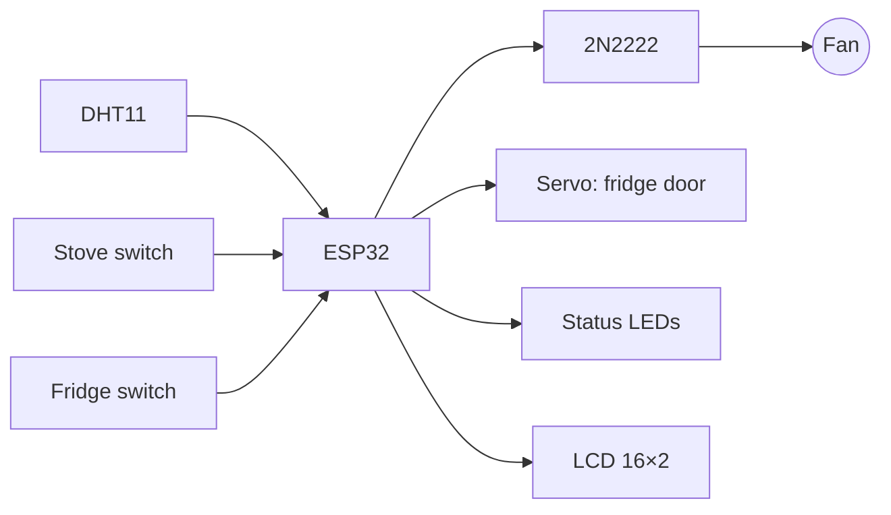

# ESP32 Smart Kitchen (scale model)

An ESP32 automates a scale-model kitchen. It monitors temperature and humidity, turns on a ventilation fan when it gets hot, and drives a stove indicator and a fridge door actuated by a servo.

> Course project, B.Sc. Mechatronics Engineering, Universidad Militar Nueva Granada.

## Behavior

| Subsystem | Input | Output | Logic |
|---|---|---|---|
| Ventilation | DHT11 (GPIO4) | DC fan through a **2N2222** transistor (GPIO26, 1 kΩ base resistor) | Fan on when T ≥ 28 °C, read every 2.5 s, NaN readings rejected |
| Stove | Switch (GPIO14) | LED (GPIO27) | LED follows the switch |
| Fridge | Switch (GPIO5) | **Servo** door (GPIO18) + interior LED (GPIO19) | Door opens to 120°; the LED shows the closed state |
| Display | none | 16×2 LCD, 4-bit parallel | Temperature and humidity |

## Design notes

- The ESP32 can't drive the fan's current directly, so a 2N2222 works as a low-side switch, with the fan forced **off at boot** to avoid a start-up glitch.
- The DHT11 is polled with `millis()` instead of `delay()`, so the switches and servo keep responding between readings.
- Switches use the internal pull-ups (`INPUT_PULLUP`), so no external resistors are needed.

## Run it

Libraries: **DHT sensor library** (Adafruit), **ESP32Servo**, **LiquidCrystal**. Board: ESP32 Dev Module. Flash `firmware/smart_kitchen/smart_kitchen.ino`.

---

<b>🇪🇸 Versión en español</b>

## Cocina inteligente con ESP32 (maqueta)

- El DHT11 mide la temperatura y la humedad. Con 28 °C o más, el ESP32 enciende un ventilador a través de un transistor 2N2222.
- Un interruptor controla el LED de la estufa.
- Otro interruptor abre la puerta de la nevera con un servo y apaga su LED interior.
- Los datos se muestran en una LCD 16×2.

